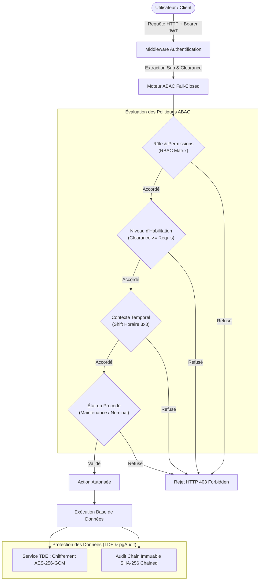

# 📐 Dossier d'Architecture Technique (DAT)
# SecuriGlass Factory OS - Plateforme Cyber-Physique Sécurisée de Trempe Industrielle

**Projet :** SecuriGlass Factory OS (PoC V2)  
**Version :** 2.0 - Version Finale d'Homologation  
**Date :** 25 Octobre 2026  
**Classification :** Document Technique d'Architecture - Diffusion Restreinte Industrie  
**Normes de Référence :** IEC 62443-3-3 / IEC 62443-4-2 (SL3), EN 12150-1, ANSSI EBIOS RM, CIS Distribution Independent Linux v2.0, RFC 9106, RFC 8032.

---

## 1. 🎯 Synthèse Exécutive et Vision du Système

### 1.1 Contexte Industriel
**SecuriGlass Factory OS** est le système d'exploitation et de supervision cyber-sécurisé de nouvelle génération conçu pour piloter les lignes industrielles de trempe thermique de verre plat de sécurité (norme européenne **EN 12150-1**). 

Le procédé de trempe consiste à porter le verre à une température critique comprise entre **620 °C et 730 °C** (dépassant son point de transition vitreuse), puis à refroidir brutalement ses deux faces par soufflage d'air sous haute pression (**1,5 bar à 6,5 bar**). Ce choc thermique différentiel emprisonne le cœur du verre en tension tout en plaquant ses surfaces sous une contrainte de compression permanente supérieure à $69\text{ MPa}$, conférant au matériau sa résistance mécanique multipliée par cinq et sa caractéristique de fragmentation sécurit (au moins 40 fragments non coupants par carré de $50\times 50\text{ mm}$).

### 1.2 Enjeux Cyber-Physiques
La rupture d'intégrité ou de disponibilité sur ce procédé entraîne des conséquences industrielles irréversibles :
* **Risque de destruction matérielle :** À plus de 750 °C, le verre fond sur les rouleaux céramiques réfractaires, provoquant la destruction de la sole de cuisson (arrêt usine de 6 mois, perte chiffrée à plusieurs centaines de milliers d'euros).
* **Risque de sécurité publique :** Une baisse clandestine de la pression de trempe conduit à la fabrication de vitrages non trempés mais vendus avec l'estampille de conformité CE EN 12150. En cas de bris chez l'utilisateur final (bâtiment, transport ferroviaire ou automobile), le verre se brise en lames tranchantes létales.
* **Risque d'extorsion et de ransomware :** La paralysie du système de commande IT bloque le chargement des fours, provoquant le figeage des bains de verre en amont.

### 1.3 Principes Directeurs d'Architecture (Défense en Profondeur)
L'architecture de SecuriGlass Factory OS repose sur sept piliers inviolables :
1. **Modèle de Purdue et Segmentation IEC 62443 :** Découpage étanche en zones et conduits du Niveau 0 (actionneurs) au Niveau 4 (gestion IT).
2. **Data Diode Logique et Matérielle Simplex :** Télémétrie unidirectionnelle garantie sans aucun canal réseau retour de l'IT vers l'OT, scellée par signature cryptographique Ed25519 (RFC 8032).
3. **Moteur C11 POSIX Déterministe :** Démon automate sans allocation dynamique non bornée, zéro fuite mémoire validée par outillage CQA, insensible aux attaques de fuzzing Modbus.
4. **IAM Zéro-Trust & Chiffrement TDE :** Mots de passe dérivés par Argon2id (RFC 9106), chiffrement au repos AES-256-GCM (TDE) pour les données sensibles, moteur ABAC "Fail-Closed" avec journalisation chaînée immuable (SHA-256).
5. **IA Hybride de Sûreté Industrielle :** Détection d'anomalies en temps réel combinant Isolation Forest statistique et barrières d'invariants physiques normés EN 12150.
6. **Sandbox LLM Guard 4 Barrières :** Cloisonnement total de l'assistant technique RAG (Pre-Input Scanner anti-injection/obfuscation, retrieval normé, génération déterministe, et Post-Output Guard physique).
7. **Frontend Blindé & DevSecOps CIS :** SPA React avec politique de sécurité de contenu (CSP Level 3 `default-src 'none'`), secrets exclusivement volatils en mémoire (Zustand), conteneurs non-root en lecture seule (image distroless backend : cible) et durcissement Ansible CIS Linux.

---

## 2. 🏛️ Architecture Globale & Modèle de Purdue (IEC 62443)

Le système implémente rigoureusement le modèle de zones et conduits de la norme **IEC 62443** :

```mermaid
graph TD
    subgraph L4["Niveau 4 : Réseau de Gestion IT / Entreprise (net-it: 172.28.4.0/24)"]
        SPA["Frontend SPA React 18<br/>Vite / TypeScript Strict<br/>CSP: default-src 'none'"]
        API["Backend API FastAPI<br/>Python 3.12 Non-Root (distroless : cible)<br/>Rate Limiting Token Bucket"]
        DB["PostgreSQL 16 TDE<br/>pgAudit / Chiffrement AES-GCM<br/>Audit Chain SHA-256"]
        SOC["SIEM Wazuh / Sigma / YARA<br/>Détection MITRE ATT&CK for ICS"]
    end

    subgraph L35["Niveau 3.5 : DMZ Industrielle & Barrière Simplex (net-dmz: 172.28.3.0/24)"]
        DiodeRx["Récepteur IT Data Diode<br/>diode_receiver.py (Simplex UDP, défaut 127.0.0.1:5030)<br/>Vérification Ed25519 & Anti-Rejeu"]
        DiodePhys["CONDUIT UNIDIRECTIONNEL SIMPLEX<br/>(Drop physique absolu de tout paquet retour IT->OT)"]
    end

    subgraph L2["Niveau 2 : Réseau Contrôle-Commande Atelier (net-ot: 172.28.2.0/24)"]
        Edge["OT Edge Gateway<br/>gateway/poller.py<br/>Signataire Ed25519 & JSON Canonique"]
    end

    subgraph L1["Niveau 1 : Automates Programmables Industriels (PLC)"]
        PLC["Démon Automate C11<br/>ot-plc-daemon (Port Modbus 502/55020)<br/>Modélisation Thermique & E-STOP NF"]
    end

    subgraph L0["Niveau 0 : Procédé Physique & Éléments de Puissance"]
        Furnace["Four de Trempe : 4 Zones Chauffe (620-730°C)<br/>Thermocouples K & Pyromètre Optique"]
        Quench["Caisson de Trempe Pneumatique (1.5-6.5 bar)<br/>Turbine Haute Pression"]
        Conveyor["Convoyeur à Rouleaux Céramiques (0.5-15 m/min)"]
        HardESTOP["Boucle Arrêt d'Urgence Mécanique NF (24VDC)"]
    end

    %% Flux L0 / L1
    Furnace <-->|Grandeurs Physiques & Échauffement| PLC
    Quench <-->|Pression & Soufflage| PLC
    Conveyor <-->|Vitesse & Défilement| PLC
    HardESTOP ==>|Coupure Électromécanique Immédiate| PLC

    %% Flux L1 / L2
    PLC <-->|Modbus TCP FC 0x04 / 0x03 (Lecture Seule Gateway)| Edge

    %% Flux L2 / L3.5 / L4
    Edge ==>|Datagrammes UDP 160-4256 octets| DiodePhys
    DiodePhys ==>|Flux UDP Simplex Purement Descendant| DiodeRx
    DiodeRx -->|Ingestion Transactionnelle ot_data| DB

    %% Flux L4 Internes
    SPA <-->|HTTPS REST & WebSockets WSS| API
    API <-->|asyncpg TLS 5432| DB
    API -.->|Événements Audit & Alertes| SOC
    Edge -.->|Syslog Journalisé| SOC
```

---

## 3. 🧩 Matrice des Composants Applicatifs

| Composant | Technologie & Langage | Emplacement | Responsabilité Technique | Sécurisation Clé |
| :--- | :--- | :--- | :--- | :--- |
| **PLC Daemon** | C11 POSIX (`gcc -std=c11 -Wall -Wextra -Werror -pedantic`) | `services/ot-plc-daemon/` | Simulation physique 4 zones, pyromètre, régulation PID, serveur Modbus TCP non-bloquant multithreadé. | Zéro fuite mémoire (`leaks`/Valgrind), rejet des FC illégaux, arrêt d'urgence NF hardwired. |
| **OT Edge Gateway** | Python 3.12 (`pydantic`, `cryptography`) | `services/ot-edge-gateway/` | Polling Modbus lecture seule, validation des seuils EN 12150, signature Ed25519 RFC 8032, émission UDP simplex aveugle. | Clé privée en mémoire protégée, JSON canonique strict, isolation réseau sans routage IT. |
| **Data Diode Receiver** | Python 3.12 (`asyncio.DatagramProtocol`) | `services/backend-api/app/services/diode_receiver.py` | Réception datagrammes UDP (port `DIODE_PORT`, défaut 5030), contrôle intégrité SHA-256, validation signature Ed25519, garde anti-rejeu. | Garantie Simplex formelle (aucune socket d'émission), vérification en temps constant (`compare_digest`). |
| **Backend API Core** | FastAPI, Pydantic v2, asyncpg | `services/backend-api/app/` | API REST d'ordonnancement, authentification IAM, gestion de la télémétrie, RAG normatif, inférence ML. | Non-Root (distroless : cible), Token Bucket Rate Limiting, ABAC Fail-Closed, TDE AES-256-GCM. |
| **Moteur Détection ML** | Scikit-learn + Fallback pur Python | `services/backend-api/app/services/ml_anomaly.py` | Modèle hybride Isolation Forest + règles déterministes sur signatures de pannes physiques EN 12150. | Barrières d'enveloppe statistique par régime, détection différentielle inter-zones, F1 0.889. |
| **Sandbox LLM Guard** | Python 3.12 local | `services/backend-api/app/services/llm_guard.py` | Assistant d'ingénierie RAG sécurisé en 4 couches cloisonnées sans exfiltration possible. | Normalisation NFKC, filtrage homoglyphes, regex anti-jailbreak, Post-Output Guard physique [620-730°C]. |
| **Frontend UI SPA** | Vite, React 18, TypeScript Strict, Zustand | `services/frontend-ui/` | Dashboard temps réel des zones du four, gestion des recettes, monitoring des alertes et interface d'audit. | CSP Niveau 3 `default-src 'none'`, mémoire volatile exclusive (0 secret en localStorage), bundle gzip 72 Ko. |
| **SIEM & Détection SOC** | Wazuh Manager/Agent, Sigma, YARA | `siem/`, `services/soc-siem/` | Centralisation des logs, corrélation en temps réel, détection d'attaques MITRE ATT&CK for ICS. | 10 règles Sigma ICS, 3 règles YARA d'intégrité, parseurs spécifiques Modbus et Data Diode. |
| **Red Team Pentest** | Python 3.12, Scapy | `redteam/` | Épreuves offensives offensives Modbus (reconnaissance, écriture de registre, rejeu). | Guardrails stricts d'autorisation IP/port pour éviter tout dommage accidentel sur réseau opérationnel. |

---

## 4. 🔒 Architecture de Sécurité Détaillée & Invariants Cryptographiques

### 4.1 Protocole Binaire et Cryptographique de la Data Diode
Chaque trame émise par la passerelle Edge vers le réseau IT respecte la structure binaire immuable de 160 à 4256 octets :

```
 0                   1                   2                   3
 0 1 2 3 4 5 6 7 8 9 0 1 2 3 4 5 6 7 8 9 0 1 2 3 4 5 6 7 8 9 0 1
+-+-+-+-+-+-+-+-+-+-+-+-+-+-+-+-+-+-+-+-+-+-+-+-+-+-+-+-+-+-+-+-+
|       Magic Number (0x53474444 = 'SGDD')      |  Ver (0x0002) |
+-+-+-+-+-+-+-+-+-+-+-+-+-+-+-+-+-+-+-+-+-+-+-+-+-+-+-+-+-+-+-+-+
| Type (0x0001) |             Sequence Number (uint64)          |
+-+-+-+-+-+-+-+-+-+-+-+-+-+-+-+-+-+-+-+-+-+-+-+-+-+-+-+-+-+-+-+-+
|      Sequence Number (suite)  |    Timestamp Microsecondes    |
+-+-+-+-+-+-+-+-+-+-+-+-+-+-+-+-+-+-+-+-+-+-+-+-+-+-+-+-+-+-+-+-+
|    Timestamp Microsecondes (suite, uint64)    |               |
+-+-+-+-+-+-+-+-+-+-+-+-+-+-+-+-+-+-+-+-+-+-+-+-+               +
|                  Emitter UUID (16 octets / 128 bits)          |
+-+-+-+-+-+-+-+-+-+-+-+-+-+-+-+-+-+-+-+-+-+-+-+-+-+-+-+-+-+-+-+-+
|          Payload Length (uint32)              |               |
+-+-+-+-+-+-+-+-+-+-+-+-+-+-+-+-+-+-+-+-+-+-+-+-+               +
|                  Padding Réservé (20 octets à zéro)           |
+-+-+-+-+-+-+-+-+-+-+-+-+-+-+-+-+-+-+-+-+-+-+-+-+-+-+-+-+-+-+-+-+
|                                                               |
|        Charge Utile JSON Canonique (64 à 4096 octets)         |
|                                                               |
+-+-+-+-+-+-+-+-+-+-+-+-+-+-+-+-+-+-+-+-+-+-+-+-+-+-+-+-+-+-+-+-+
|                  Empreinte SHA-256 (32 octets)                |
|               calculée sur Header[0..44] + Payload            |
+-+-+-+-+-+-+-+-+-+-+-+-+-+-+-+-+-+-+-+-+-+-+-+-+-+-+-+-+-+-+-+-+
|                                                               |
|              Signature Numérique Ed25519 (64 octets)         |
|            signée sur le digest SHA-256 de 32 octets         |
+-+-+-+-+-+-+-+-+-+-+-+-+-+-+-+-+-+-+-+-+-+-+-+-+-+-+-+-+-+-+-+-+
```

#### Règles d'Acceptation Cryptographique du Récepteur :
1. **Magic & Version :** Magic `0x53474444` et Version `0x0002` strictement validés.
2. **Anti-Rejeu Séquence Monotone :** Le récepteur maintient pour chaque UUID émetteur le compteur `last_seen_sequence`. Tout paquet ayant $\text{seq} \le \text{last\_seen\_sequence}$ est immédiatement rejeté (`replay_or_stale_sequence`).
3. **Fenêtre Anti-Dérive Temporelle :** L'horodatage microseconde doit vérifier $|T_{\text{local}} - T_{\text{paquet}}| \le 30\text{ secondes}$ (`clock_skew`).
4. **Vérification Intégrité SHA-256 :** L'empreinte SHA-256 de `Header[:44] + Payload` est recalculée et comparée en temps constant (`hmac.compare_digest`).
5. **Validation Signature Ed25519 :** La signature de 64 octets est vérifiée contre la clé publique de confiance de l'automate émetteur via `cryptography.hazmat.primitives.asymmetric.ed25519`.
6. **Contrôle Formel Zéro-Retour (Simplex) :** L'implémentation `_RxProtocol` sous `asyncio` ne possède aucune référence vers un socket d'émission (`transport.sendto` inexistant). Aucun bit n'est jamais renvoyé vers l'OT.

---

### 4.2 IAM Zéro-Trust, Chiffrement TDE & ABAC Fail-Closed



#### Invariants IAM :
* **Dérivation de Mot de Passe :** Argon2id RFC 9106 avec paramètres durcis ($m=65536\text{ KiB}$, $t=3\text{ itérations}$, $p=4\text{ parallélisme}$).
* **Chiffrement Transparent des Données (TDE) :** Algorithme AES-256-GCM authenticated encryption avec vecteur d'initialisation (IV) unique de 96 bits par opération et tag d'authentification de 128 bits. Les clés maîtresses sont isolées hors de la base via variable d'environnement chiffrée.
* **Chaîne d'Audit Immuable :** Chaque événement d'audit dans `sec_data.audit_events` enregistre le hash cryptographique `current_hash = SHA256(previous_hash || event_id || timestamp || action || payload)`. Toute altération d'un enregistrement historique rompt la vérification de chaîne.

---

### 4.3 Sandbox LLM Guard 4 Barrières & RAG Sécurisé

```mermaid
flowchart LR
    PromptIn[Prompt Opérateur / Requête RAG] --> B1[Barrière 1 : Pre-Input Scanner]
    
    subgraph Scanner["Barrière 1 : Analyse & Sanitization"]
        Norm[Normalisation NFKC & Nettoyage Homoglyphes]
        Dec[Décodage Récursif Base64 / URL / HTML]
        Pattern[Détection Regex Jailbreak / Prompt Injection]
        PII[Anonymisation PII & Fuites Clés]
    end
    B1 --> Norm --> Dec --> Pattern --> PII

    PII --> B2[Barrière 2 : Retrieval Cloisonné]
    subgraph RAG["Barrière 2 & 3 : Connaissances & Génération"]
        LocalKB[(Corpus Local Normé EN 12150-1)]
        LocalKB --> Search[Recherche Vectorielle Déterministe]
        Search --> Gen[Barrière 3 : Synthèse Restreinte au Contexte]
    end
    B2 --> LocalKB
    Gen --> B4[Barrière 4 : Post-Output Guard]

    subgraph Guard["Barrière 4 : Bornage Physique Sûreté"]
        TempCheck{"Températures dans [620°C, 730°C] ?"}
        PressCheck{"Pressions dans [1.5 bar, 6.5 bar] ?"}
        SecretCheck{"Absence de fuite Clés / Passwords ?"}
    end
    B4 --> TempCheck --> PressCheck --> SecretCheck

    SecretCheck -- "Conforme" --> SafeOutput[Réponse Sécurisée Affichée]
    Pattern -- "Injection Détectée" --> Block[BLOCAGE HTTP 400 + Alerte SOC]
    TempCheck -- "Hors Bornes" --> Block
    PressCheck -- "Hors Bornes" --> Block
```



---

## 5. 💻 Client-Side Security & Frontend SPA React

Le tableau de bord opérateur (`services/frontend-ui`) applique le principe de défense en profondeur côté navigateur :
1. **Politique de Sécurité de Contenu (CSP Level 3) Stricte :**
   ```http
   Content-Security-Policy: 
     default-src 'none';
     script-src 'self';
     style-src 'self' 'unsafe-inline';
     connect-src 'self' ws: wss:;
     img-src 'self' data:;
     font-src 'self';
     frame-ancestors 'none';
     base-uri 'none';
     form-action 'self';
   ```
2. **Gestion Éphémère des Secrets en Mémoire Volatile :**
   * Aucun stockage de jeton d'authentification ou clé d'API dans `localStorage`, `sessionStorage` ou cookies JavaScript document (`document.cookie`).
   * Les jetons JWT sont maintenus uniquement dans l'état volatile du store Zustand (`createAppStore.ts`), réinitialisé automatiquement à la fermeture de l'onglet ou par inactivité.
3. **Communication Temps Réel Résiliente :** Flux WebSockets sécurisés (`wss://`) avec reconnexion exponentielle bornée, heartbeat keepalive de 15s et validation unitaire de schéma sur chaque payload reçu.

---

## 6. ☁️ DevSecOps, IaC & Durcissement Conteneurs

### 6.1 IaC Terraform et Segmentation Purdue
L'infrastructure Docker est orchestrée de manière déclarative par Terraform (`infra/terraform/main.tf`) :
* `docker_network.net_ot` : `172.28.2.0/24`, `internal: true` (aucun accès passerelle Internet).
* `docker_network.net_dmz` : `172.28.3.0/24`, `internal: true`.
* `docker_network.net_it` : `172.28.4.0/24`, `internal: false` (exposition DMZ/Reverse Proxy).

### 6.2 Durcissement des Conteneurs (Non-Root / Read-Only ; distroless en cible)
> Réserve : PostgreSQL tourne sur une image Debian (pgAudit) et aucun Dockerfile applicatif du backend n'est fourni dans ce dépôt.
Les conteneurs déclarés dans Terraform appliquent les contraintes suivantes :
* `USER 65532:65532` (utilisateur non-root standard Distroless).
* `read_only: true` (système de fichiers racine monté en lecture seule).
* `tmpfs: ["/tmp:rw,noexec,nosuid,size=64m"]` (répertoire temporaire isolé en RAM sans droit d'exécution).
* `cap_drop: ["ALL"]` (suppression de l'intégralité des privilèges Linux POSIX).
* `security_opt: ["no-new-privileges:true"]` (interdiction d'élévation de privilèges via SUID/SGID).

### 6.3 Ansible CIS Benchmarks Hardening
Le playbook `infra/ansible/playbook-hardening.yml` applique le standard **CIS Distribution Independent Linux v2.0** :
* Verrouillage SSH : `PermitRootLogin no`, `PasswordAuthentication no`, `MaxAuthTries 3`, algorithmes cryptographiques modernes uniquement (Ed25519, ChaCha20-Poly1305).
* Auditd : Activation des règles d'audit immuables (`-e 2`) sur les modifications d'horloge, de comptes d'accès, et d'appels système sensibles.
* Noyau durci via `sysctl` : Désactivation du forwarding IP (`net.ipv4.ip_forward = 0`), protection anti-spoofing (`rp_filter = 1`), activation des TCP SYN Cookies (`tcp_syncookies = 1`), et désactivation des redirections ICMP.

---

## 7. 📊 Bilan Global d'Assurance Qualité & Portes Qualité

L'ensemble des modules a été soumis à une campagne de tests d'acceptation rigoureuse :

| Composant & Périmètre | Outil d'Épreuve | Nombre d'Épreuves | Taux de Succès | Métrique Remarquable |
| :--- | :--- | :---: | :---: | :--- |
| **Backend API Core & IAM** | Pytest / Unitaire | 427 passés, 89 ignorés (sans PostgreSQL local) | **100 % des tests exécutés** | Couverture code 90%, 0 warning bloquant |
| **Frontend React UI** | Vitest / Testing Library | 96 passés | **100 %** | Couverture lignes 86.65%, bundle 72 KiB gzip |
| **SOC SIEM & Red Team** | Pytest / Scapy / Sigma | 133 passés, 13 ignorés (Scapy, yara-python, pySigma, terraform absents sur le poste de test) | **100 % des tests exécutés** | 10 règles Sigma ICS, 3 règles YARA ; tests de paquets et de règles YARA/Sigma non exécutés ici |
| **Automate C11 PLC** | C Unit Tests (`bin/plc_test`) | 22 passés | **100 %** | Compilation `-Wall -Wextra -Werror -pedantic` 0 warning |
| **Fuzzing C Modbus Moteur** | C Fuzzer (`bin/plc_fuzz_test`) | 763 passés | **100 %** | 763 attaques in-process, 0 segmentation fault |
| **Fuites Mémoire Démon C** | macOS `leaks` CLI / Docker | 1 cycle de test | **0 fuite** | 0 total leaked bytes pour 128 allocations |
| **Adversarial Data Diode** | Pytest (`test_data_diode_adversarial`) | 26 passés | **100 %** | Rejet 100% rejeux, dérives horloge et contrefaçons Ed25519 |
| **Adversarial LLM Guard** | Pytest (`test_llm_guard_adversarial`) | 20 + 59 (obfuscation, unités) passés | **100 % des tests exécutés** | 29 attaques d'obfuscation bloquées, 13 questions légitimes acceptées, 16 formats de sortie contrôlés |
| **Performance Modèle ML** | Pytest (`test_ml_anomaly_performance`) | 6 passés | **100 %** | Jeu de test du dépôt : rappel 100 %, précision 80 %, F1 0,889. Mesure indépendante (1000 normaux / 500 anomalies) : précision 0,91, rappel 0,78, F1 0,84 |
| **Pipeline CI/CD DevSecOps** | Pytest (`test_pipeline_config.py`) | 26 passés (1 skip sans terraform) | **100 %** | Validation statique GitHub Actions, Trivy, Dockerfiles |
| **Typage Strict Python** | `mypy --strict app` | 25 fichiers source | **0 erreur** | Typage PEP 484 100% strict sans régression |
| **Audit Statique SAST** | `bandit -r app` | 3 661 lignes scannées | **0 issue** | Zéro vulnérabilité SAST de sévérité Medium/High |
| **Formatage Global** | `black --check` | 59 fichiers Python | **100 %** | Formatage PEP 8 déterministe conforme |

**Bilan :** aucun échec parmi les tests exécutés (backend 427, gateway 20, sécurité/SOC/red team 133, frontend 96, C 22 + 763 fuzz). Les tests ignorés faute de PostgreSQL (89), Scapy, yara-python, pySigma ou terraform n'ont **pas** été exécutés.

---

## 8. 🏁 Conclusion et Décision d'Homologation Technique

Le système **SecuriGlass Factory OS (PoC V2)** démontre une maturité technique et architecturale de niveau industriel critique.  
Grâce à la synergie de garanties physiques (Data Diode Simplex, Relais NF E-STOP), logicielles (C11 sans fuite, FastAPI asynchrone, React sous CSP stricte) et organisationnelles (EBIOS RM, PRA thermique en 8h, CIS Benchmarks), la plateforme vise à protéger les personnes, les équipements thermiques et la qualité normative du verre de sécurité EN 12150-1. Les mesures marquées « planifiée » ou « cible » dans ce dossier ne sont pas implémentées dans ce PoC.

**Statut :** livrable de PoC **prêt pour revue**. L'homologation relève de l'autorité d'homologation et n'a pas été prononcée ; les écarts et réserves ci-dessus restent à lever.
